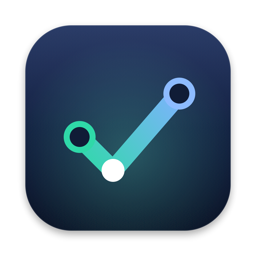

<p align="center">
  
</p>

<h1 align="center">GitKleen</h1>

<p align="center">
  <b>A light, fast, native git client, for remote repositories too</b><br>
  JetBrains' commit graph and history, VS Code's way of staging, under 7 MB and open in a moment; for repositories on this computer or over SSH.<br>
  Made for coding with agents too: <code>gitkleen .</code> refreshes as the agent works, so you check its changes, stage what's right and hand the rest back.
</p>

<p align="center">
  <a href="https://github.com/leoheung/GitKleen/actions/workflows/ci.yml"></a>
  
  
  
  
</p>

<p align="center">
  <b>English</b> · <a href="README.zh-CN.md">简体中文</a>
</p>

## Why GitKleen

With an agent writing the code, most of your time in git goes to looking at what changed. GitKleen makes that quick:

1. **See** every change as it lands: the window refreshes while the agent works, each file side by side with syntax highlighting. Lockfiles, minified and generated files fold away, and changed pictures show before and after.
2. **Keep** what's right: fix a line right in the diff, stage the files, changes or lines you want, and commit.
3. **Send back** what isn't: comment on the lines to redo, copy the comments as Markdown, each with its file, lines and code, and paste them to Claude Code, Codex or a colleague.

GitKleen reads the repository, not an agent's session, so it works the same with any agent, with several at once, and with your own edits.

| How you look at an agent's changes today | What GitKleen does instead |
|---|---|
| The agent's own diff view | Works with every agent, and lets you stage single lines and fix the code before you commit |
| Opening an IDE | Opens in a moment, in a fraction of the memory |
| `git diff` in a terminal | Side by side, generated files folded, refreshed as the agent works |

### Light, fast and modern

GitKleen feels like the IDE you know: JetBrains' commit graph and history tools, VS Code's list of changes and way of staging, ⌘K for commands and ⌘P to go to a file, light and dark. Without the IDE: it's a single native binary drawn on the GPU by `https://github.com/egoist/mygo`, no webview, no JVM. Memory once a repository of 20,000 commits is open, every process of the app counted (Apple M4):

| App | Memory |
|---|---|
| **GitKleen** | **109 MB** |
| A trimmed IntelliJ-based client | 750 MB |
| VS Code, no extensions | 1,000 MB |
| VS Code, 167 extensions | 1,400 MB |
| IntelliJ IDEA 2026.2 | 2,300 MB |

On the same repository, GitKleen reads the whole history and lays out its graph in **0.13 s** and opens a commit with a 20 MB patch (5,677 files) in **0.24 s**.

GitKleen reads what `git` prints and lets `git` itself make every change, so a repository behaves in GitKleen exactly as it does in a terminal. The same app, with the same features, runs on macOS, Windows and Linux.

## A fork of MyGit

GitKleen is a fork of `https://github.com/Binaryify/MyGit` by Binaryify — itself already a light, fast, native git client for local and SSH remote repositories, under the MIT license. That foundation is worth keeping, so GitKleen keeps it: the same idea of reading what `git` prints and letting `git` itself make every change, the same features, the same single small binary.

Two things are better done in a fork than upstream:

- **Its own updates.** An installed app looks for updates where it was built to — MyGit's releases, signed with MyGit's key — so anything you build yourself is a dead end: the copies you hand out can never update to it. GitKleen signs its updates with its own key and serves them from its own releases, so what you install is what you keep.
- **Its own direction.** The interface went on being reworked here — the branches column, the diff drawer, the tags and stashes panels, and the rest of what's new below — work easier to do on a fork than in someone else's project. The name and the icon too: `gitkleen .` on the command line, `~/.gitkleen` on computers reached over SSH.

The license stays MIT, and MyGit's original copyright is kept in [LICENSE](LICENSE).

## What's new in GitKleen

Everything MyGit does, plus what GitKleen's [0.2.0](CHANGELOG.md) adds over MyGit 0.3.5, the last upstream release:

**Tags and stashes**

- Each tag's row shows its commit's hash under the name and its date at the right; clicking a row goes to that commit in the history and selects it
- Stashes sort by time and filter by keyword; clicking one opens its diff right away, and a single change can be stashed from its own row
- Choosing a row in tags or stashes unchooses the row picked before — there or in the history — so one thing is selected at a time, never one highlighted while another's diff shows

**The window**

- Branches moved out of the title bar's dropdown into a column beside the workspace, remote branches grouped in folders, with a search bar over branches and repositories
- Branches, stashes and tags are tabs above the column
- The diff opens in a drawer at the window's right
- A taller slate title bar: the branches block, the actions centered, and pull and push counts where an arrow used to be
- The changes panel: the two lists swap places, the commit box sits under them, and stashing lives in their header

**Over SSH**

- GitKleen tries the keys set for git's remote operations first, the default one before the rest, before it ever asks

**And the name**

- GitKleen's own name, icon and command line (`gitkleen .`); its helper lives in `~/.gitkleen` on computers it reaches over SSH; updates are signed with its own key and come from its own releases

## Features

- **Reading changes** — generated files (lockfiles, minified, `linguist-generated`) fold away; mark files viewed; changed pictures show before and after; comment on lines and copy the comments as Markdown for an agent or a colleague
- **Staging** — stage, unstage or discard files, changes or selected lines; edit and save the working tree in the diff; filter thousands of changes by path
- **Commits** — whole messages, changed files and side-by-side diffs with syntax highlighting; a merge against any parent; compare two commits (⌘-click), a branch or the working tree; amend the last commit from its menu; leave the hooks out when you mean to (`--no-verify`)
- **History** — every branch, tag and remote with its graph, streamed as it loads; search by message, author or hash; filter by branch or path (file history)
- **History tools** — branch, tag, check out, cherry-pick, revert, reset (soft / mixed / hard) and interactive rebase (reorder, reword, edit, squash, fixup, drop)
- **Pull requests** — open a GitHub pull request, read and reply to its threads under their lines, resolve them, and submit a review: comment, approve or request changes
- **Conflicts** — a three-pane merge view, and continue, skip or abort a merge, rebase, cherry-pick or revert
- **Stash, blame and remotes** — stash with untracked files, blame a file line by line, manage remotes, pull (fast-forward, rebase or merge), preview a push, force with lease
- **Sign-ins** — when git needs a username, token or passphrase, the window asks
- **Workspaces** — open a folder of repositories, as an agent's working folder over a few of them, and each shows in the sidebar with its own message, sync and changes, as VS Code's source control has them
- **Over SSH** — open a repository on another computer (`host:/path/to/repo`, Linux, macOS or Windows) with your ssh config and keys; GitKleen runs a small helper there, in `~/.gitkleen`, and needs only git on it. On Windows, the distributions of WSL open the same way, without sshd (`wsl+Ubuntu:~/repo`)
- **Everywhere** — a window per repository, drag folders in, `gitkleen .` from a terminal, custom title bars, light and dark (the system's or chosen in Settings), English and 简体中文, signed auto-updates

## Install

Download the latest release:

| Platform | Download |
|---|---|
| macOS (Apple silicon) | `https://github.com/leoheung/GitKleen/releases/latest/download/GitKleen-macos-arm64.dmg` |
| Windows (x64) | `https://github.com/leoheung/GitKleen/releases/latest/download/GitKleen-windows-amd64-setup.exe` · `https://github.com/leoheung/GitKleen/releases/latest/download/GitKleen-windows-amd64.zip` |
| Linux (x64) | `https://github.com/leoheung/GitKleen/releases/latest/download/GitKleen-linux-amd64.deb`, or the script below |
| Linux (arm64) | `https://github.com/leoheung/GitKleen/releases/latest/download/GitKleen-linux-arm64.deb`, or the script below |

On Linux, this installs GitKleen for you in `~/.local`, without root:

```bash
curl -fsSL https://github.com/leoheung/GitKleen/releases/latest/download/install.sh | sh
```

GitKleen isn't notarized by Apple yet. If macOS says it can't be opened, move it to Applications and run:

```bash
xattr -dr com.apple.quarantine /Applications/GitKleen.app
```

The Windows installer isn't code-signed yet either. If Windows says it protected your PC, choose **More info**, then **Run anyway**.

GitKleen needs `git` on the `PATH`, and updates itself once installed. Intel Macs aren't supported. All releases are on the `https://github.com/leoheung/GitKleen/releases`.

To build it from source instead, see [Development](#development).

## Shortcuts

| Keys | Does |
|---|---|
| ⌘↩ / Ctrl+Enter | Commit |
| ⌘F / Ctrl+F | Search the history |
| ⌘R / Ctrl+R | Refresh |
| ⌘P / Ctrl+P | Go to a file of the commit or the changes |
| ⌘K / Ctrl+K | Commands |
| ⌘S / Ctrl+S | Save the file edited in the diff |
| F7 / ⇧F7 | Next / previous change in the diff; past the last, press again for the next file |
| Space | Stage or unstage the change chosen; mark a commit's file viewed |
| Delete | Discard the change chosen |
| ⌘-click | Compare two commits |

## Development

```bash
git clone https://github.com/leoheung/GitKleen.git && cd GitKleen   # needs Go 1.27 or later
go tool mygo dev      # run, reloading on changes
go tool mygo build -platform darwin/arm64,windows/amd64,linux/amd64,linux/arm64
```

The texts live in [`locales/`](locales): `en.json` is the source and `zh-Hans.json` its Chinese. After changing them, run `go tool mygo generate`. Translations into other languages are welcome: add `locales/<tag>.json`.

To release, describe the version in [`CHANGELOG.md`](CHANGELOG.md), whose section becomes the release notes, and push a tag such as `v0.2.0`: CI signs the updates with the `MYGO_UPDATER_PRIVATE_KEY` secret, builds the macOS disk image, the Windows installer and zip, and the Linux package, and publishes them in a release. The signing key (`mygo-update.key`, from `mygo keygen`) lives in that secret — lose it and installed apps can't update again.

Over SSH: a release also builds and signs the helper for six platforms (`gitkleen-helper-<os>-<arch>.gz`), which the app downloads and checks the first time it reaches a computer of each. To try local changes, `go run ./internal/tools/helpers` builds them into `build/helpers`; start the app with `GITKLEEN_HELPER_DIR=$PWD/build/helpers`.

## Credits

Based on `https://github.com/Binaryify/MyGit` by Binaryify, under the MIT license.

## License

[MIT](LICENSE)
